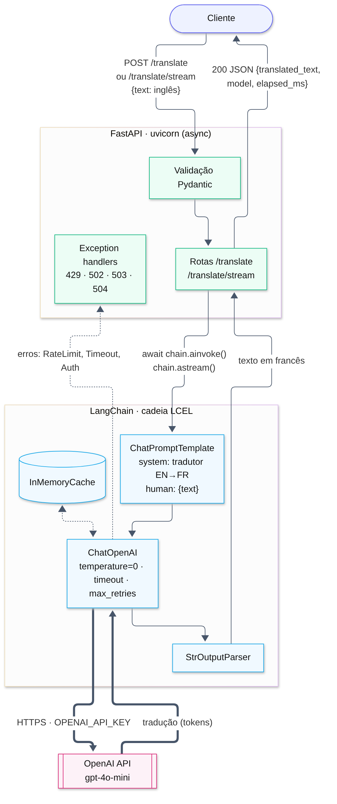
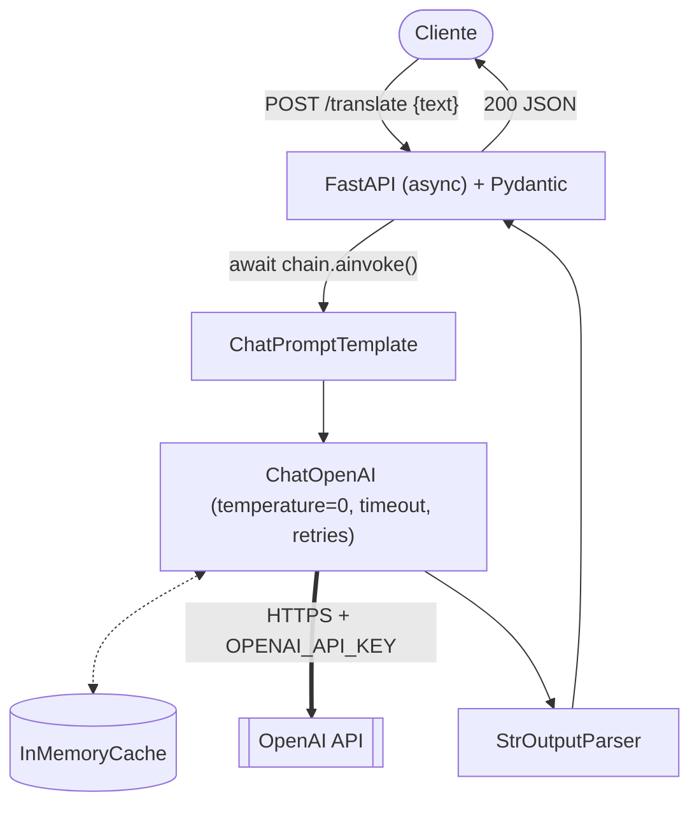

# Parte 2 · Questão 2 — Tradução EN → FR com OpenAI via LangChain (FastAPI)

API que recebe um texto em inglês, traduz para o francês com um modelo da **OpenAI** orquestrado
pelo **LangChain** (`ChatPromptTemplate | ChatOpenAI | StrOutputParser`) e devolve JSON.
Funciona como a API da Parte 1 · Q2, mas o modelo local (MarianMT) é substituído por um LLM na nuvem.

## Arquitetura



<details><summary>Código Mermaid do diagrama</summary>


</details>

| Componente | Papel |
|---|---|
| **FastAPI** | Recebe e valida a requisição (Pydantic), injeta a cadeia (`Depends`) e converte erros da OpenAI em códigos HTTP. |
| **LangChain** | Monta o prompt de tradução, chama o modelo, faz cache e parse da saída; isola o código do SDK do provedor. |
| **OpenAI API** | Executa o modelo (`gpt-4o-mini` por padrão, configurável) e devolve a tradução. |

## Como a aplicação busca baixa latência e robustez

| Decisão | Efeito |
|---|---|
| Rotas `async` + `chain.ainvoke()` | A espera pela rede não bloqueia o event loop, então um processo atende muitas requisições simultâneas. |
| Cliente/cadeia criados **uma vez** no `lifespan` | Reaproveita conexões HTTP (keep‑alive), sem recriar o cliente a cada requisição. |
| Modelo pequeno (`gpt-4o-mini`) + `temperature=0` | Respostas mais rápidas e determinísticas. |
| `InMemoryCache` do LangChain | Textos repetidos são respondidos do cache (~ms), sem nova chamada nem custo. |
| `POST /translate/stream` | Streaming: o cliente recebe os primeiros tokens antes da tradução terminar. O primeiro pedaço é lido antes de responder, então erros da OpenAI viram o status HTTP certo (e não um "200" vazio). |
| `timeout` + `max_retries` (backoff) | Falhas transitórias/429 são re‑tentadas; requisições presas não ficam pendentes. |
| Exception handlers | `429` (limite de requisições: vale tentar de novo), `503` (sem chave ou **conta sem créditos**: tentar de novo não resolve), `504` (timeout), `502` (autenticação/erro do provedor). |
| Prompt de sistema | Pede **só** a tradução e instrui o modelo a não obedecer instruções contidas no texto (mitiga prompt injection). |

## Estrutura

```
app/
├── main.py      # FastAPI: lifespan, rotas, tratamento de erros da OpenAI
├── chain.py     # prompt de tradução, build_llm() (ChatOpenAI) e build_translation_chain()
├── schemas.py   # modelos Pydantic
└── config.py    # configurações (OPENAI_API_KEY, modelo, timeout, retries, cache)
tests/           # testes com FakeListChatModel (sem custo) + teste real opcional
```

## Como executar

Pré‑requisitos: Python 3.10+ e uma chave de API da OpenAI.

```bash
python -m venv .venv
```

```bash
source .venv/bin/activate        # Windows: .venv\Scripts\activate
```

```bash
pip install -r requirements.txt
```

```bash
cp .env.example .env             # edite e coloque sua OPENAI_API_KEY (nunca versione o .env)
```

```bash
uvicorn app.main:app --reload
```

Swagger: http://127.0.0.1:8000/docs

### Exemplos

```bash
curl -X POST http://127.0.0.1:8000/translate -H "Content-Type: application/json" -d '{"text": "Good morning! How are you today?"}'
```

Formato da resposta (**exemplo ilustrativo**: não foi executado sem uma chave; o texto e o tempo variam):

```json
{
  "source_language": "en",
  "target_language": "fr",
  "original_text": "Good morning! How are you today?",
  "translated_text": "Bonjour ! Comment allez-vous aujourd'hui ?",
  "model": "gpt-4o-mini",
  "elapsed_ms": 812.4
}
```

Streaming (texto puro, chega em partes):

```bash
curl -N -X POST http://127.0.0.1:8000/translate/stream -H "Content-Type: application/json" -d '{"text": "It is raining cats and dogs."}'
```

Sem chave configurada, a API sobe mas indica o problema (comportamento real verificado):

```text
GET  /health     -> {"status":"ok","model":"gpt-4o-mini","api_key_configured":false}
POST /translate  -> 503 {"detail":"Serviço indisponível: OPENAI_API_KEY ausente."}
```

Com uma chave válida mas **conta sem créditos** (verificado com a API real da OpenAI):

```text
POST /translate  -> 503 {"detail":"Conta da OpenAI sem créditos. Adicione créditos para usar a API."}
```

A OpenAI usa o mesmo HTTP 429 para "muitas requisições" e "sem créditos"
(`type: insufficient_quota`, `code: credit_balance_exhausted`); a API distingue os dois casos.

### Testes

Os testes **não** chamam a OpenAI: o `ChatOpenAI` é substituído por `FakeListChatModel`, mas o
prompt e o parser reais são exercitados; erros da OpenAI (429, timeout, 401) são simulados.

```bash
pytest -q
```

Com `OPENAI_API_KEY` definida, um teste extra faz uma tradução real (pago).

### Configuração

| Variável | Padrão | Descrição |
|---|---|---|
| `OPENAI_API_KEY` | — | Chave da OpenAI (obrigatória) |
| `APP_OPENAI_MODEL` | `gpt-4o-mini` | Modelo de chat da OpenAI |
| `APP_REQUEST_TIMEOUT_S` | `30` | Timeout por chamada (s) |
| `APP_MAX_RETRIES` | `2` | Re‑tentativas com backoff |
| `APP_ENABLE_CACHE` | `true` | Cache em memória de traduções repetidas |

### Qualidade de código

O projeto usa o [ruff](https://docs.astral.sh/ruff/) (configuração em `ruff.toml`) como linter e formatador:

```bash
pip install ruff && ruff check . && ruff format --check .
```

## Referências

- LangChain + OpenAI: https://python.langchain.com/docs/integrations/chat/openai/
- OpenAI rate limits: https://platform.openai.com/docs/guides/rate-limits
- Uso de IA: desenvolvido com apoio do assistente Claude (Anthropic) como ferramenta de apoio; o código foi revisado, testado e é compreendido pelo autor.
